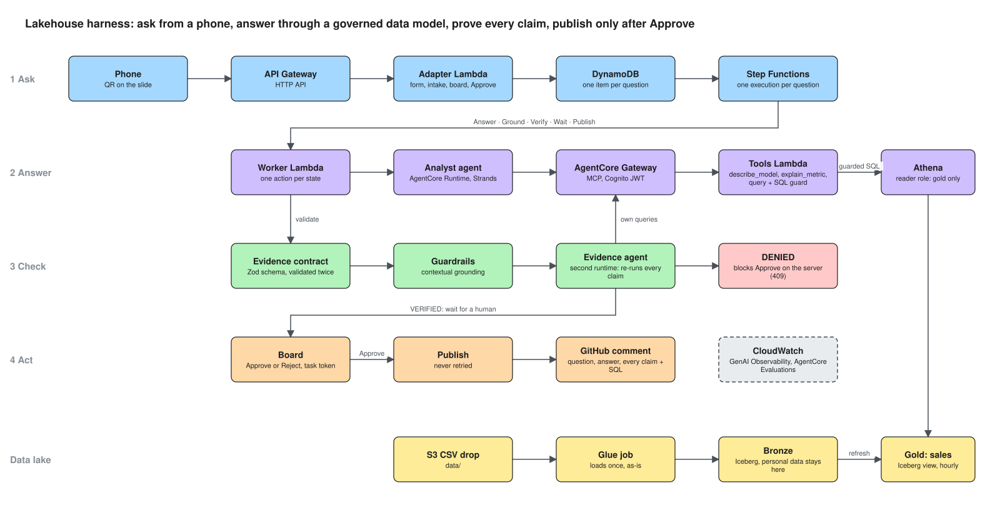

# Lakehouse Harness

**Harness Engineering, live: a grounded lakehouse agent on Amazon Bedrock AgentCore.**

Ask the company lakehouse a question from your phone. An agent answers through a governed data model, never the raw
tables. Every number it quotes has to come from the rows it cites. A second agent re-runs every claim and denies what it
cannot reproduce. Bedrock Guardrails checks the answer, and nothing is published until a human presses Approve.

Companion code for two AWS user-group talks (Linköping 29 Oct 2026, Stockholm 5 Nov 2026) and Part 3 of the
[Harness Engineering](https://builder.aws.com/content/3HfiXvfzDCTk6OT5ryfygmpJu6W/harness-engineering-building-an-ops-agent-with-agentcore-and-strands)
series. The slides are in [`talk/`](talk/).

## The solution

## Repository layout

| Folder | What lives there |
|---|---|
| `packages/shared` | The contract (Zod schemas), the data model, the SQL guard and the number checks. Every other package depends on it. |
| `packages/agent` | The analyst and the evidence agent: one Strands app, deployed twice to AgentCore Runtime. |
| `packages/tools` | The lakehouse tools Lambda behind AgentCore Gateway: `describe_model`, `explain_metric`, `query`. |
| `packages/api` | The questions API: `handlers/` (Lambda entrypoints), `http/` (the fast path: form, intake, board), `workflow/` (the slow path: one step per state). |
| `packages/evaluators` | The SqlGuard code-based evaluator for AgentCore Evaluations. |
| `packages/board` | The big board (React, Vite). |
| `tooling/` | `bundle-lambda.mjs`, the one esbuild configuration every Lambda package builds with. |
| `infra/` | Terraform. `modules/lambda` defines a function the project way; the rest is one file per concern. |
| `data-model/` | The governed data model as Markdown with front matter; compiled into `packages/shared` and Terraform. |
| `golden/`, `fixtures/` | The golden question set with expected answers, and recordings the board can replay. |
| `scripts/` | Operations: seed, reset, invoke, golden evaluation, lakehouse generation. |
| `talk/` | The slides. |

Every Lambda follows one convention: the entrypoint is `src/handlers/<name>.ts`, it bundles to `dist/<name>/index.mjs`,
and Terraform points at that folder with `module "<name>"`. The entrypoint reads the environment and builds the AWS
clients; everything it wires is plain functions with tests.
